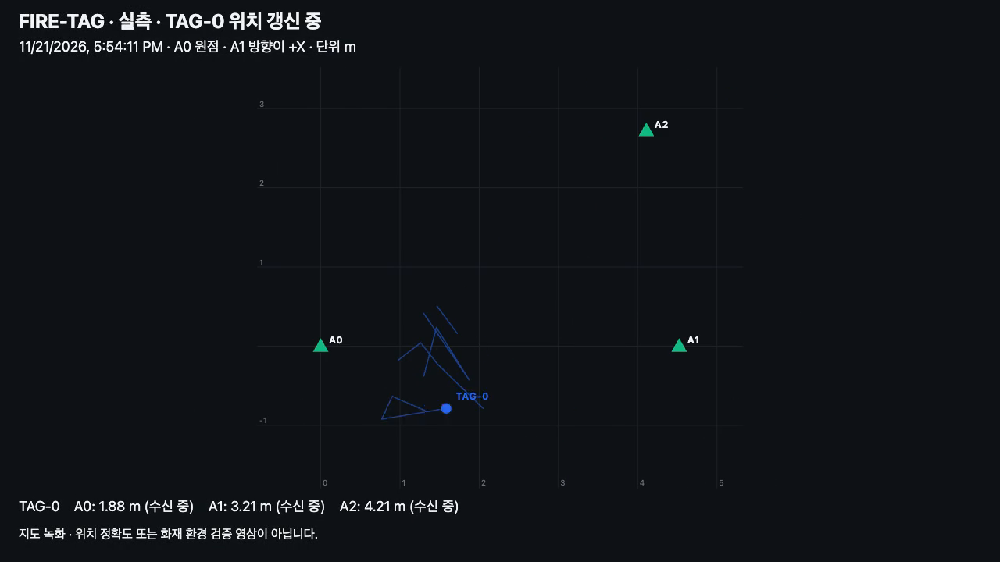

# 2026-11-21 플라스틱 통·UWB 복구 시험

## 판정 범위

첫 번째 통에서는 덮개를 닫은 채 60초 동안 A0·A2 100%, A1 99.0%의 Tag 교환 성공률을 기록했습니다. 해당 통과 해당 배치에서 통신한 사실만 확인했습니다. 재질은 사용자의 추정인 PLA, 두께는 약 2 mm이며 실측·재질 확인은 하지 않았습니다.

두 번째 통은 최초 닫힘에서 A2 수신 83.36%·최대 9.7초 위치 공백이 있었고, 다시 닫은 시험은 세 앵커 모두 100%였습니다. 이후 실제 이동 영상에도 10.103초 위치 공백이 있어 전체 안정성은 정상 완료로 판정하지 않았습니다. 일반 플라스틱, 인체 가림, 화재 환경, 실제 위치 정확도까지 검증한 결과가 아닙니다.

## 장비·방법

- Wi-Fi: Mobile_504, Pi 대시보드 `http://192.168.68.104:8080/`. IP는 DHCP 변경 가능.
- A0: Pi의 USB 3.0 포트. A1·A2는 ESP-NOW로 A0에 보고. Tag 0은 Mac USB에 연결.
- 통신: Tag↔앵커 UWB DS-TWR ch9, A1/A2→A0 ESP-NOW ch1, A0↔Pi USB 115200. ESP32에 접속 Wi-Fi의 SSID를 넣는 구조가 아님.
- **매 시험 전에 앵커 번호·위치·방향·전원을 서로 확인하고 고정합니다. 배치가 바뀌면 세 쌍 A0–A1/A0–A2/A1–A2를 다시 측정합니다. USB 열거 순서를 앵커 번호로 사용하지 않습니다.**
- 각 조건 60초. Tag의 1초 요약을 합산하고 Pi 상태 API를 약 0.5초마다 수집. Tag의 성공은 RESP 수신 및 FINAL 송신 경로의 성공이며, 앵커의 FINAL 수신률과 동일한 지표가 아님.
- API는 위치·수신 시각 확인용 표본입니다. API 표본 수는 RF 패킷 수가 아닙니다. 시간 경계 때문에 60초 수집에 602회가 포함된 구간이 있습니다.
- 원본은 실행 PC의 `raspberrypi/data/plastic_20261121/`에 보존. 원시 실행 데이터·DB·WebM 원본은 Git 추적에서 제외.
  요약 수치와 복구 로그 발췌는 [시험 요약](evidence/20261121/test_summary.json), [복구 기록](evidence/20261121/recovery_excerpt.json), [펌웨어 해시](evidence/20261121/firmware_manifest.json)에 함께 저장합니다. 원본 영상은 로컬에 보존하고 보고서용 영상은 별도로 첨부합니다.

## 첫 번째 통 결과

| 조건·파일 접두어 | A0 성공/시도 | A1 성공/시도 | A2 성공/시도 | API 위치 끊김 표본 |
|---|---:|---:|---:|---:|
| 닫힘, A2 장애 중 `B1_enclosed_164404` | 600/600 | 600/600 | 0/600 | 114/114 |
| 덮개만 열림 `A1_lid_open_164837` | 600/600 | 600/600 | 0/600 | 114/114 |
| A2 재시작 후 열림 `A2_lid_open_after_reboot_165159` | 600/600 | 600/600 | 600/600 | 0/115 |
| 재시작 후 다시 닫힘 `B2_lid_closed_after_reboot_165653` | 602/602 | 596/602 | 602/602 | 0/115 |

열린 정상 구간은 최대 위치 나이 0.4초, 다시 닫은 구간은 0.3초였습니다. 닫힌 정상 구간의 A1 성공률은 99.0%입니다. 두 조건 사이의 1% 차이를 통의 영향으로 확정할 반복시험·대조군은 없습니다.

장애 중에도 세 앵커의 상태 보고는 이어졌습니다. 덮개를 열어도 A2는 회복되지 않았고 A2 재시작 후 회복됐으므로, 최초 장애를 플라스틱 차폐 탓으로 판정할 수 없습니다.

## 두 번째 통 결과

재질·두께는 미확인입니다. A2를 기존 A1 자리로 옮긴 뒤 새 삼각형을 고정하고 재교정했습니다. A0–A1 4.486 m, A0–A2 4.936 m, A1–A2 2.749 m, 반복 측정 산포 0.030 m, 총 79표본(각 쌍 39/20/20)입니다. 산포는 실제 위치 오차가 아닙니다.

| 조건 | A0 성공/시도 | A1 성공/시도 | A2 성공/시도 | API 위치 끊김 표본 | 최대 위치 나이 |
|---|---:|---:|---:|---:|---:|
| 닫힘 `C1_second_box_closed_after_firmware_174329` | 601/601 | 601/601 | 501/601 (83.36%) | 15/115 | 9.7초 |
| 덮개만 열림 `C2_second_box_lid_open_174546` | 600/600 | 600/600 | 600/600 | 0/115 | 0.2초 |
| 다시 닫힘 `C3_second_box_closed_repeat_174755` | 600/600 | 600/600 | 600/600 | 0/115 | 0.4초 |

각 조건 약 60초 수집 중 API 오류는 없었고 앵커 상태 보고는 유지됐습니다. 다시 닫은 시험에서도 정상 수신했으므로 최초 A2 공백을 덮개의 영향으로 재현하지 못했습니다. 해당 통 안에서 통신 가능함은 확인했으나 간헐적 RF 정지의 최초 원인과 장시간 안정성은 미해결입니다.

## 확인한 장애와 변경

1. **상태 보고와 UWB 측정 정지가 함께 나타남.** ESP32가 살아 있어도 UWB 교환은 멈출 수 있습니다. LED가 보이지 않는 현상만으로 전원 차단을 확정하지 않습니다.
2. **Tag의 이전 교환 이벤트 정리 누락.** 다음 POLL 전에 송수신을 중단하고 RX/TX/timeout/error 이벤트를 정리하도록 수정했습니다.
3. **침묵한 앵커의 수신 재시작 부재.** 마지막 정상 교환 뒤 2초에 수신 재시작, 10초에 DW3000 재초기화. 추가 재초기화는 최소 10초 간격. MCU·경보 상태는 유지하며 초기화 실패 중 RF 사용을 중단합니다.
4. **진단 추가.** DEV_ID, SYS_STATUS, SYS_STATE, 직전 실패 상태, 재시도 횟수를 기록합니다. `ready=true`는 설정 성공이며, 실제 거리 교환 전에는 복구 성공으로 판정하지 않습니다.
5. **Pi 시리얼 정지.** 기존 pyserial 경로에서 수신이 정지한 뒤 표준 POSIX 경로에서 재개되는 현상을 확인했습니다. 드라이버 원인까지 규명한 것은 아닙니다. POSIX 경로로 통일하고 부분 쓰기·쓰기 시간 제한·같은 포트 재접속을 처리했습니다. 전송하지 못한 명령을 전송 완료로 계산하지 않습니다.
   - 재접속 첫 쓰기 앞에 줄바꿈을 넣고, A0는 필수 인자·범위·줄 끝을 검사해 불완전 명령을 거부합니다. `tty.setraw`는 출력 drain을 기다리지 않도록 즉시 적용합니다.
   - 재시작 명령이 일부 전송된 뒤 끊기면 실행 여부 불명으로 기록하고 자동 재전송하지 않습니다. 마지막 줄바꿈만 유실된 경우 다음 구분 줄바꿈으로 지연 실행될 수 있으므로 ‘failed’가 미실행 보장은 아닙니다.
6. A0의 별도 기록에 `rst:0x7 (TG0WDT_SYS_RESET)` 부팅 반복이 있습니다. 이는 Timer Group 0 watchdog 리셋 표기이며 전압 강하의 증거와 동일하지 않습니다. [Espressif reset reason](https://docs.espressif.com/projects/arduino-esp32/en/latest/api/reset_reason.html), [watchdog 문서](https://docs.espressif.com/projects/esp-idf/en/stable/esp32/api-reference/system/wdts.html).

**한계:** 상대 장비 부재·전파 가림도 침묵 타이머를 작동시킵니다. 재초기화 코드는 전원·배선 불량을 수리하지 않습니다. 최초 RF 정지 원인은 확정되지 않았습니다.

## 좌표·동선 판정

16:41 교정은 A0–A1 5.134 m, A0–A2 4.434 m, A1–A2 2.394 m였습니다. 17:02 교정은 각각 5.127 m, 5.695 m, 2.512 m였습니다. A0–A2가 1.261 m 달라졌습니다. 배치 변경 여부와 독립된 실측 거리가 없으므로 실제 정확도를 보증할 수 없습니다. 표본의 분산이 작다는 사실은 실제 거리의 정확성과 다릅니다.

동선 표시만 최근 15초로 줄였습니다. 0.3 m 미만 흔들림을 생략하고 최소 0.5초 간격으로 표시하며, 1초 초과 공백이나 `max(1 m, 3 m/s × 시간 간격)` 초과 이동 사이에는 선을 잇지 않습니다. 원본 좌표·CSV는 그대로 보존합니다. 이 기준은 보기 위한 규칙이며 실제 측정 오차가 제거됐다는 뜻은 아닙니다.

거리만으로 만든 상대 삼각형에는 절대 방위·좌우 방향 정보가 없습니다. 화면 좌우 반전은 앵커·Tag·동선·거리 원에 함께 적용하며 숫자와 글자는 뒤집지 않습니다. 실제 건물의 좌우가 맞는지는 현장 기준점 대조가 필요합니다.

## 정식 화면에 적용한 내용

- 기본 실행은 정식 대시보드. 경량 ZIP은 기록용으로 보존.
- 앵커 상태 보고와 Tag의 앵커별 UWB 수신 시각을 구분. API 연결이 끊기면 저장된 상태로 실시간 표시·명령 버튼을 다시 활성화하지 않음.
- 선택 Tag의 거리·상태 우선 표시, 동선·거리 원 선택. 잔차를 보장 정확도 `±`로 표시하지 않음.
- 재교정 도중과 완료 직후, 이전 좌표계의 위치·동선을 숨김.
- 가상 건물·층별·다중 Tag 화면은 `?demo=1`로 분리. 시뮬레이션 표시, 물리 경보·재시작·실측 CSV 차단. 추가 Tag/Pi의 실제 동시 시험은 사용자 요청으로 보류.

참고한 원제조사 기능은 [MSA LUNAR](https://us.msasafety.com/explore-lunar?locale=en)의 방향·거리 중심 표시와 [Qwake NAVIGATOR](https://www.qwake.tech/navigator)의 시각 정보 구성입니다. 해당 제품의 성능을 FIRE-TAG가 갖췄다는 뜻은 아닙니다. 현재 없는 LoRa·IMU·나침반·열화상·자동 층 판정은 구현됐다고 표시하지 않습니다.

## 벽·방을 고려한 지도

층 전체를 모서리 앵커 3개로 모두 측정할 수 있다는 가정을 제거합니다. 가상 지도는 방·복도 구역을 선택하면 그 구역 안의 비공선 앵커 3개 설치 후보를 표시합니다. 다른 방과 벽 너머는 수신 미검증 구역입니다. 벽 투과율이나 보장 반경을 가정해 정상 수신으로 칠하지 않습니다.

앵커 1개는 거리 1개만 제공합니다. 현재 2D 계산에는 서로 다른 앵커 3개가 필요하므로 ‘방마다 1개’는 방 내부 좌표를 보장하는 배치가 아닙니다. 방별 독립 배치가 반드시 필요한지, 열린 문·복도를 통해 인접 구역 앵커를 사용할 수 있는지는 현장에서 비교해야 합니다. 설치 후보도 실측 수신율·실제 거리 오차를 검증하기 전에는 확정 배치가 아닙니다.

장애물의 재질·두께·주파수에 따라 감쇠가 달라지고, 통신 가능한 거리와 직접 경로를 정확히 검출할 수 있는 거리는 다를 수 있습니다. 벽 뒤에서 패킷이 수신돼도 거리 측정 오차가 남을 수 있습니다. [Qorvo/Decawave APS006, 2.2·4장](https://forum.qorvo.com/uploads/short-url/bVkGY18xEsijUq0OAm6iU64JeqF.pdf). 이 자료는 DW1000 대상이므로 RF 현상 설명에 참고했으며 DW3000의 보장 거리나 수치 보정값으로 사용하지 않았습니다.

현재 실제 펌웨어·수신기는 구역 1개의 A0/A1/A2 구성을 지원합니다. 여러 구역에 같은 번호·PAN·채널의 앵커를 단순 복제하면 구역을 구분하는 주소·스케줄이 없습니다. 다중 구역을 실제로 운영하려면 구역 식별, Tag의 구역 전환·충돌 제어, Pi별 데이터 통합과 좌표계 등록을 추가해야 합니다. 이번 가상 지도는 해당 기능의 구현·실기 시험 결과가 아닙니다.

사용자가 A2를 기존 A1 자리에 옮겼다고 확인했습니다. 보드 번호는 유지하고 새 고정 배치에서 앵커 세 쌍을 재측정합니다. 이전 삼각형 좌표를 새 배치의 현재 위치로 사용하지 않습니다.

## 진행 기록

- host 펌웨어 회귀시험 5개, Pi Python 시험 34개, 화면 Node 시험 12개 통과. Tag/A0/A1/A2 Arduino 빌드와 최종 A0 엄격 파서 빌드 통과.
- Tag 0 복구 펌웨어 업로드 및 flash hash 검증 완료.
- 추가 USB 보드는 로그 `anchor=2`와 기존 MAC 기록을 대조해 A2로 확인. A2 업로드와 정상 거리 증가 확인. A0도 업로드·flash hash 검증 후 세 앵커의 Tag 거리 보고를 확인했습니다.
- A1은 기존 플래시 기록의 MAC과 현재 장치 MAC을 대조했습니다. A1도 업로드·flash hash 검증을 마쳤습니다. 새 배치 교정·두 번째 통 비교·이동 녹화 결과는 위 표와 아래 최종 기록에 정리했습니다.
- Dia에서 가상 층 전환·좌우 반전·명령 차단 화면을 확인했습니다. 지도 녹화 검증용 가상 영상은 VP9 1280×720, 56프레임, 마지막 프레임 시각 11.299초입니다. 가상 영상은 실측 시험 영상이 아닙니다.

### 복구 동작 실기 확인

Tag를 EN 리셋으로 의도적으로 15초 멈춘 시험에서 A0는 약 2초에 재arm, 약 10초에 DW3000 재초기화를 기록했습니다. Tag 재개 후 A0·A2 거리 보고가 다시 들어왔습니다. A0의 상태 보고는 해당 구간에도 34개 기록됐습니다. `A0_deliberate_tag_pause.json`에 35초 원본을 저장했습니다. 자연 발생한 RF 정지와 같은 고장을 주입한 시험은 아니므로, 모든 정지 유형에서의 자동 복구를 입증한 것은 아닙니다.

### 최종 배포 확인

A0 최종 USB 파서를 다시 업로드하고 flash hash 검증을 통과했습니다. Pi의 receiver/web/HTML SHA256이 작업 브랜치 파일과 일치하고 Pi에서 Python 컴파일도 통과했습니다. 이후 재교정은 A0–A1 4.524 m, A0–A2 4.931 m, A1–A2 2.756 m, 산포 0.049 m, 각 쌍 20개씩 총 60표본으로 완료됐습니다. 전체 점검 명령 #11에 A0/A1/A2 모두 성공 ACK를 회신했습니다.

### 실제 이동 영상과 남은 문제

사용자가 Tag를 움직이고 있다고 확인한 상태에서 [60초 실측 지도 영상](evidence/20261121/live_map_test.mp4)을 저장했습니다. 화면 전체·현장 카메라 영상 대신 실제 지도와 수신 상태를 녹화한 것입니다. MP4는 H.264 1280×720, 5 fps, 300프레임, 60.000초이며 WebM 원본은 로컬에 별도 보존했습니다.

영상 구간에 **10.103초의 위치 갱신 공백 1회**가 DB에서 확인됐습니다(17:53:51.555 → 17:54:01.657 KST). 2초 후 위치 끊김 이벤트, 재수신 후 복구 이벤트가 기록됐고 이 상태도 영상에 포함했습니다. 범위의 시작·끝은 브라우저 녹화 종료 파일명에서 추정해 인코딩·콜백 지연만큼 경계 오차가 있습니다. [영상 구간 DB 요약](evidence/20261121/moving_video_window.json).

별도 `C4_moving_after_final_firmware_175406` 수집은 60.02초 동안 세 앵커 모두 600/600회, API 115표본 중 끊김 0회, 최대 위치 나이 0.4초였습니다. **이 수집은 영상의 앞선 끊김이 끝난 뒤 시작해 영상 후반과 일부만 겹치므로, 영상 전체 무중단의 근거가 아닙니다.** 실제 이동 경로를 자·외부 측위 장비로 대조하지 않았습니다.

결론: 해당 플라스틱 통 안에서의 통신, 재초기화 후 재수신, 새 앵커 배치 반영, 실측 지도 녹화는 확인했습니다. **이동 중 간헐적 끊김의 최초 원인과 장시간 안정성은 해결·검증 완료로 표시하지 않습니다.** 사용자가 센서를 정리하겠다고 하여 추가 실기 시험은 중단했습니다. 다음 진단은 A2가 멈춘 순간의 직접 UART 상태 로그와 같은 배치의 전원·배선·안테나 가림 비교가 필요합니다.
