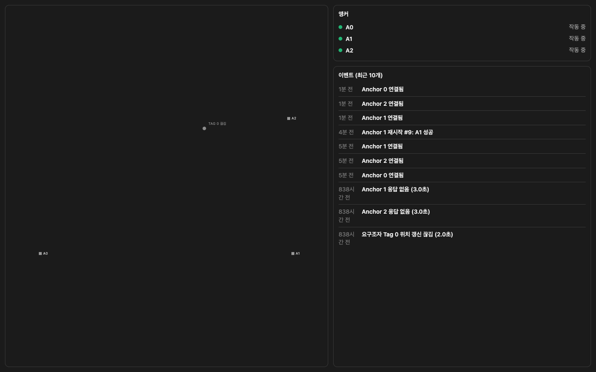

# 11월 16일 발표 자료 — FIRE-TAG 경량 UI

작성·시험일: 2026-11-09. 이번 발표는 ESP32·UWB 통신 확인 이후 **Raspberry Pi 수신과 경량 UI 구성까지** 다룹니다.

## 1. 지난 발표와 이번 발표

| 구분 | 발표 내용 |
| --- | --- |
| 지난 발표 | UWB 모듈을 ESP32에 연결하고 통신되는지 확인 |
| 이번 발표 | 앵커 데이터를 Pi로 전달하고, 앵커 상태·저장 좌표·최근 이벤트를 경량 웹 화면에 표시 |

이번 자료에는 기존 전체 UI의 동선·경보·명령 버튼이나 층별 확장 계획을 발표 기능으로 포함하지 않습니다.

## 2. 사용 장치와 데이터 흐름

- 요구조자 Tag: LOLIN D32 + DWM3000EVB, 1개
- 고정 앵커: ESP32 DevKitC + DWM3000EVB, 3개
- 수신·저장·웹 표시: Raspberry Pi

```text
Tag ↔ 앵커 A0·A1·A2             UWB 거리 측정
A1·A2 → A0                    ESP-NOW 데이터 전달
A0 → Raspberry Pi             USB 시리얼
Pi 수신기 → SQLite → 웹 화면   데이터 저장·표시
휴대폰·Mac → Pi                같은 Wi-Fi에서 HTTP 접속
```

## 3. 경량 화면에 남긴 기능

- 평면도에 앵커 위치와 Tag의 마지막 저장 좌표 표시
- Tag 좌표가 갱신되면 점 위치 갱신, 동선은 표시하지 않음
- 앵커 상태: 작동 중 / 수신 기록 없음 / 응답 없음
- 최근 이벤트 10개
- Tag 데이터가 오래되면 `끊김`, 웹 API 접속이 실패하면 `Pi 연결 끊김` 표시
- 외부 CDN·인터넷 자료를 가져오지 않는 화면



화면은 실제 Pi 접속 시험 캡처입니다. 캡처 당시 Tag 점은 오래된 저장 좌표이며 `끊김` 상태입니다. 이 이미지를 실시간 이동 성공 화면으로 설명하지 않습니다.

## 4. 이번 시험에서 확인한 내용

| 시험 | 확인 결과 |
| --- | --- |
| Tag ↔ 앵커 | Tag 재시작 후 A0·A1·A2 거리 응답 로그 확인 |
| 앵커 → Pi | A0 재시작 후 세 앵커의 새 상태 데이터 수신 확인 |
| Pi 웹 서버 | Mac에서 HTML과 API 접속 확인 |
| 실제 화면 녹화 | 약 30초 녹화, API 응답 54회 모두 HTTP 200, 브라우저 스크립트 오류 0건 |
| 경량 UI 기능 시험 | 별도 시험 DB로 점 이동·오래된 Tag 표시·이벤트 10개·연결 실패와 복구 확인 |
| 기존 코드 회귀 시험 | Python 자동 시험 13개 통과 |
| Wi-Fi 설정 | Mobile_504 유지, Hanbat_506 추가 등록. Hanbat_506 실제 접속 시험은 보류 |

UI 기능 시험의 좌표는 시험용 데이터입니다. 실제 UWB 측정 영상과 혼동하지 않습니다.

## 5. 현재 남은 확인 사항

이번 배치에서 A0–A2와 A1–A2 직접 거리 보고는 수신됐지만, A0–A1 보고는 수신되지 않았습니다. 가림막 제거 후에도 이번 시험 중에는 세 쌍의 교정이 완료되지 않았습니다. 원인은 아직 확정하지 않았습니다.

따라서 **경량 화면과 데이터 수신은 확인했지만, 이번 배치에서 새 좌표를 계산해 이동하는 시험은 완료하지 못했습니다.** 기존 저장 좌표를 새 측정으로 대체해 설명하지 않습니다. 실제 위치 오차와 화재 현장 신뢰성도 이번 발표의 검증 결과에 포함하지 않습니다.

## 6. 시연 자료와 접속

- [실제 Pi 대시보드 접속 시험 영상](Pi_경량UI_실제접속시험.mp4)
- 현재 경량 화면: `http://192.168.68.102:8080/lite`
- 네트워크를 바꾸면 Pi에서 `hostname -I`로 새 주소 확인
- 발표 전 매번 앵커 번호·고정 배치·세 쌍의 상호 거리를 확인하고 교정 완료 여부 확인

기존 화면은 별도 파일과 `/full` 주소로 보존했습니다. 이번 발표는 `/lite` 화면을 사용합니다.

## 발표 설명 예시

지난 발표에서는 UWB 모듈과 ESP32를 연결해 통신되는지 확인했습니다. 이번에는 앵커에서 받은 데이터를 Raspberry Pi에 저장하고 웹 화면으로 보여주는 단계까지 진행했습니다. 화면은 현재 위치 점, 앵커 상태, 최근 이벤트만 남긴 경량 버전입니다. 실제 Pi에 접속해 세 앵커 상태와 웹 갱신을 확인했습니다. 다만 이번 배치에서는 앵커 한 쌍의 거리 측정이 완료되지 않아 새 좌표의 이동 시험은 남아 있습니다. 따라서 이번 결과는 통신과 경량 화면 구현까지로 설명하겠습니다.
