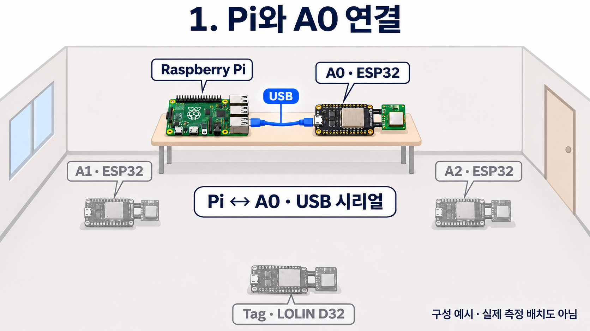
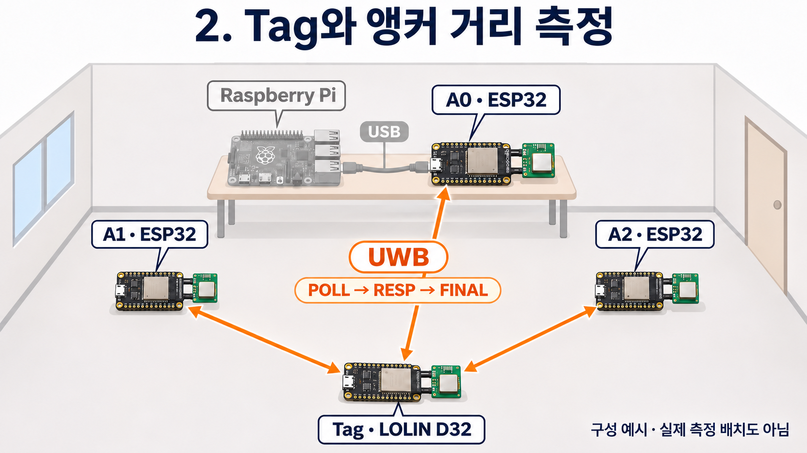
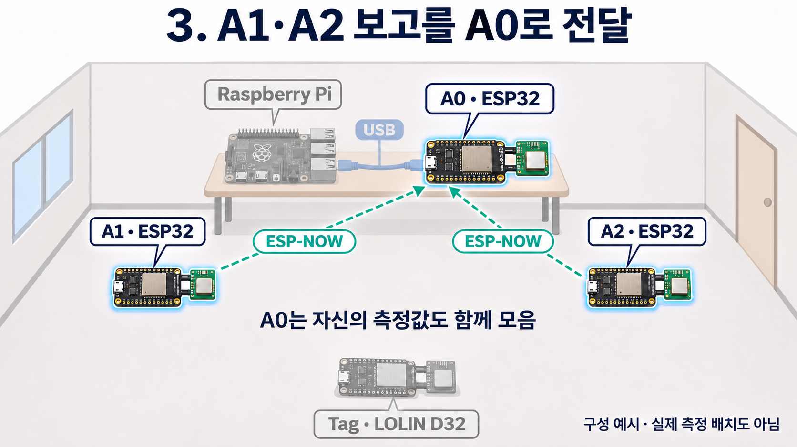
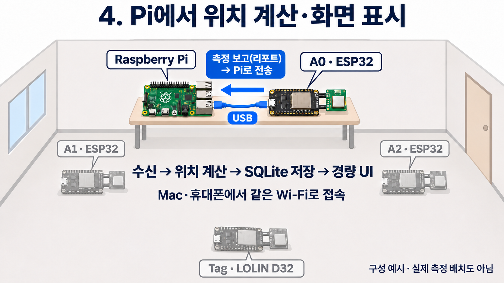

# FIRE-TAG 단계별 설명 자료

같은 실내 구성에서 장치 위치를 유지하고, 설명할 연결만 단계마다 강조했습니다. PPT에서는 이미지를 한 장씩 넘기며 설명합니다. 그림은 설명용 예시이며 실제 교실 사진·실측 배치도가 아닙니다.

## 1. Pi와 A0 연결

**설명할 내용:** 중앙 라즈베리파이와 A0 ESP32를 USB로 연결합니다. A0는 나머지 앵커의 보고를 모아 Pi로 전달하는 게이트웨이입니다.

**발표 문장:** “먼저 중앙의 라즈베리파이와 A0 ESP32를 USB 케이블로 연결했습니다. A1과 A2는 Pi에 USB로 연결하지 않습니다.”

시험 전에는 A0·A1·A2 번호와 고정 배치를 확인하고, 앵커 세 쌍의 직접 거리 측정으로 좌표를 교정합니다. 교정 완료 후 Tag 위치 시험을 시작합니다.

## 2. Tag와 앵커 거리 측정

**설명할 내용:** Tag와 A0·A1·A2가 UWB로 통신합니다. Tag가 POLL을 보내고 앵커가 RESP로 응답하며, Tag가 FINAL을 보냅니다. 거리값은 앵커에서 계산합니다.

**발표 문장:** “Tag가 세 앵커와 UWB 신호를 주고받아 각 앵커까지의 거리를 측정합니다. 이 단계에서는 아직 Pi 화면에 위치를 그리는 것이 아니라 거리값을 얻습니다.”

## 3. A1·A2 보고를 A0로 전달

**설명할 내용:** A1·A2는 거리와 상태 보고를 ESP-NOW로 A0에 보냅니다. A0는 자신의 측정값도 함께 모읍니다. ESP-NOW 보고를 Pi가 직접 수신하는 구조는 아닙니다.

**발표 문장:** “양옆의 A1과 A2가 측정한 값을 ESP-NOW로 중앙의 A0에 보냅니다. A0는 자기 측정값과 받은 보고를 모아 Pi로 전달합니다.”

## 4. Pi에서 위치 계산·화면 표시

**설명할 내용:** A0의 USB 시리얼 보고를 Pi가 읽습니다. 교정된 앵커 좌표와 Tag 거리값으로 위치를 계산해 SQLite에 저장하고, 경량 웹 서버가 화면에 표시합니다. 같은 Wi-Fi의 Mac·휴대폰으로 접속합니다.

**발표 문장:** “Pi는 USB로 받은 거리값으로 위치를 계산하고 저장합니다. 마지막으로 경량 웹 화면에 위치 점, 앵커 상태, 최근 이벤트를 보여줍니다.”

이 그림 뒤에 [실제 화면 캡처](Pi_경량UI_실제화면.png)와 [실기 영상](Pi_경량UI_실제접속시험.mp4)을 보여주면 설명과 실제 동작을 연결할 수 있습니다.

## 추가 구상: 당김식 배터리 트리거

배터리 트리거는 위 네 단계의 구현 결과와 구분합니다. 설명이 필요한 경우 [트리거 구상 문서](../트리거_구상/BATTERY_PULL_TRIGGER.md)의 이미지를 부록으로 사용하고, 실물 동작 미검증임을 표시합니다.

## 이미지 생성 기록

내장 image_gen 기능으로 네 단계의 그림은 기존 이미지에서 편집했고, 트리거 그림은 별도로 생성했습니다. 최종 프롬프트는 [단계별 이미지 생성 기록](images/단계별/생성_기록.md)과 [트리거 이미지 생성 기록](../트리거_구상/images/당김식_배터리트리거_생성기록.md)에 저장했습니다.
