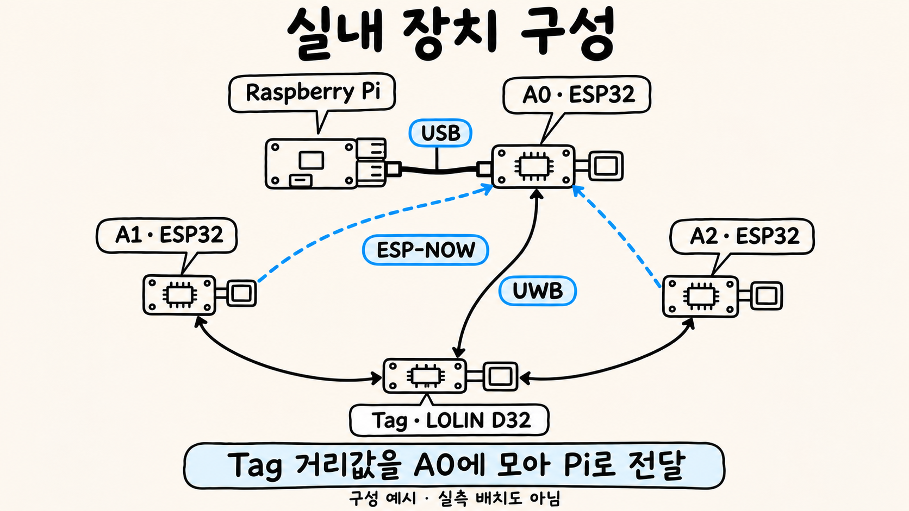
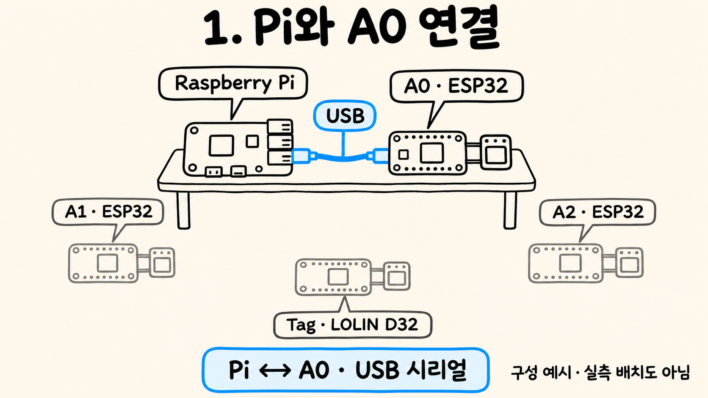
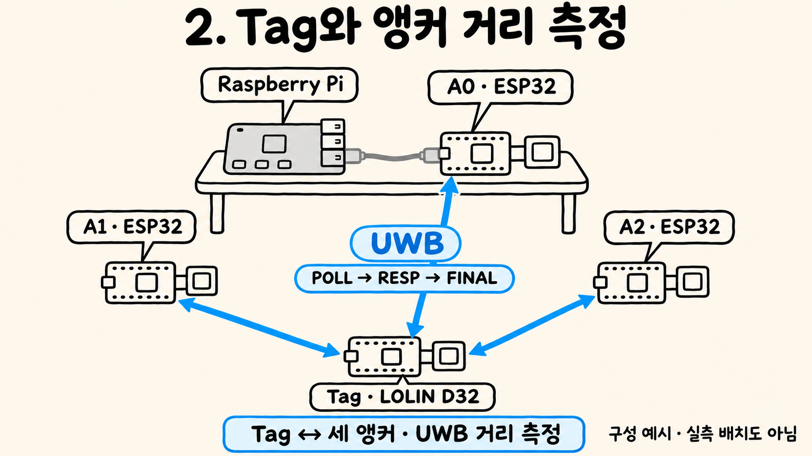
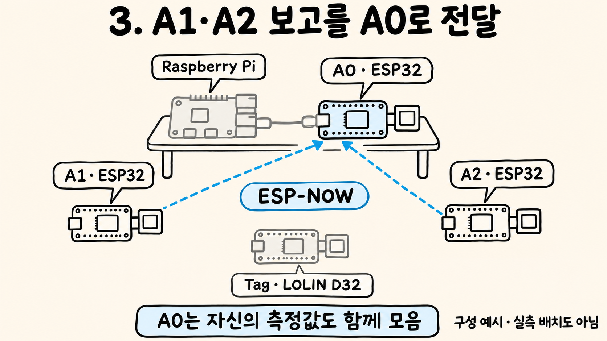
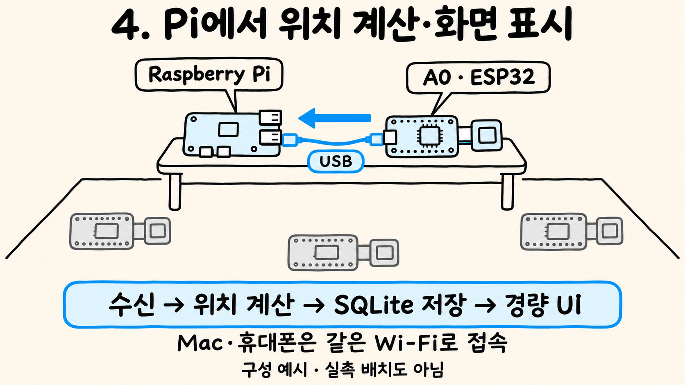
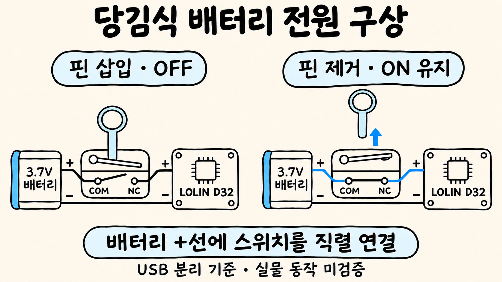
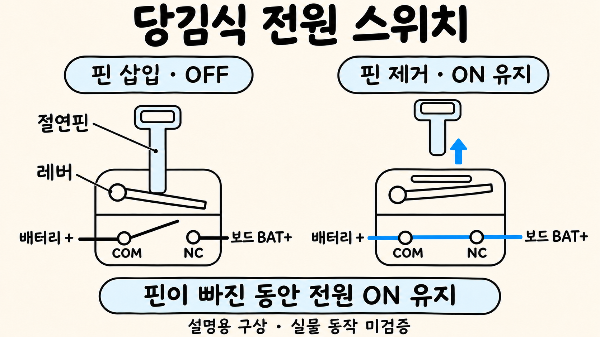
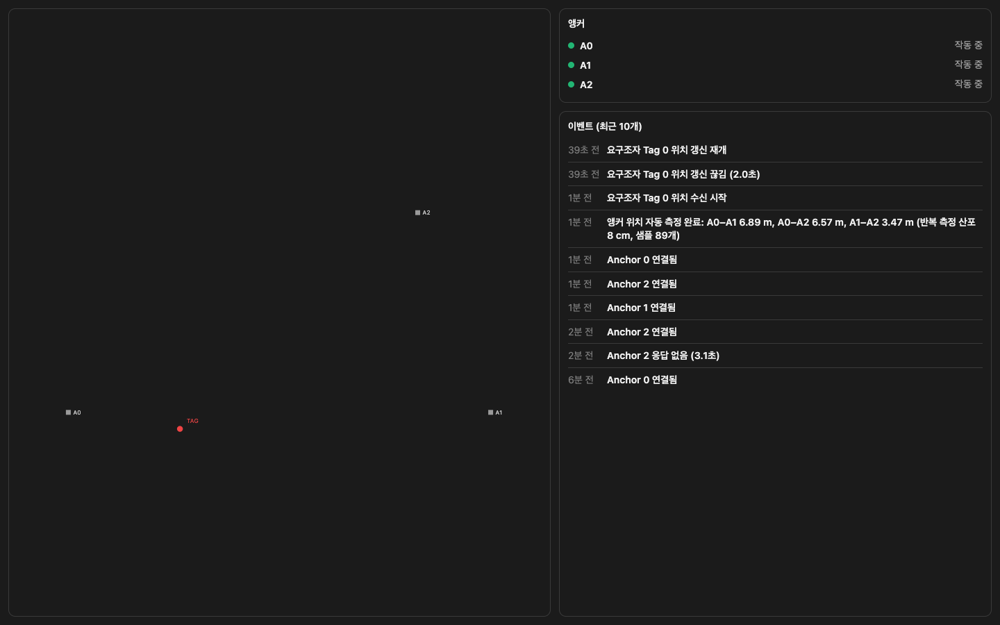

# 11월 16일 발표 이미지 목록

생성 이미지 7장과 실제 UI 캡처 1장을 이 폴더에 모았습니다. 생성 이미지는 16:9, 아이보리 배경, 검은 손글씨·펜 선, 하늘색 한 계열 강조를 적용했습니다. 실제 UI 캡처는 원본 그대로입니다.

1번은 전체 구성 소개, 2~5번은 단계별 설명, 6~7번은 선택 부록인 전원 트리거 구상에 사용합니다.

## 1. 실내 장치 구성

- [그림 1] UWB 거리 측정과 A0를 통한 Pi 전달의 전체 구조

- Tag↔앵커 UWB는 양방향. A1/A2→A0 ESP-NOW는 단방향 보고. Pi–A0만 USB 연결.

## 2. 1. Pi와 A0 연결

- [그림 2] Pi와 A0 사이의 USB 시리얼 연결

- Pi와 A0 사이 USB만 강조. Pi에 UWB 모듈을 직접 연결하지 않음.

## 3. 2. Tag와 앵커 거리 측정

- [그림 3] Tag와 세 앵커 사이의 UWB 왕복 통신

- Tag↔A0/A1/A2 모두 양방향, Pi로 UWB 화살표 금지. 절차 POLL/RESP/FINAL 순서.

## 4. 3. A1·A2 보고를 A0로 전달

- [그림 4] A1·A2가 A0로 보내는 ESP-NOW 측정 보고

- ESP-NOW 화살표 두 개의 끝은 A0 보드. Pi나 Tag에 도착하지 않음.

## 5. 4. Pi에서 위치 계산·화면 표시

- [그림 5] Pi의 USB 수신·위치 계산·저장·화면 표시

- USB 보고 방향 A0→Pi. SQLite는 위치 계산 이후. Wi-Fi는 Pi 웹 접속용이며 UWB와 분리.

## 6. 당김식 배터리 전원 구상

- [그림 6] 배터리 양극 직렬 스위치의 OFF·ON 연결 구상

- 핀 삽입→레버 눌림→COM–NC 개방/OFF. 핀 제거→레버 복귀→COM–NC 연결/ON. 음극 직결.

## 7. 당김식 전원 스위치

- [그림 7] 분리핀·레버·COM–NC 접점의 동작 확대 구상

- 그림은 기구 개념도. 절연핀의 하중/레버 방향과 COM–NC 상태가 일치해야 함. 스위치의 실물 단자 위치 도면 아님.

## 8. 실제 Pi 경량 UI

- [그림 8] 실제 Pi에서 제공한 경량 화면의 원본 캡처

- 이미지 생성으로 만든 UI가 아닌 실제 접속 기록. 원본과 바이트 일치 확인 대상.

## 사용 자료

- [단계별 발표 문장](../경량버전/단계별_설명자료.md)
- [PPT 이미지·영상 삽입안](../경량버전/PPT_이미지_삽입안.md)
- [트리거 구상·구매 목록](../트리거_구상/BATTERY_PULL_TRIGGER.md)
- [최종 생성 프롬프트·검수 항목](이미지생성프롬프트_FIRE-TAG_11월16일.md)

구성도는 실측 배치도가 아닙니다. 트리거는 실물 제작·동작 시험 전의 설명용 구상입니다.
