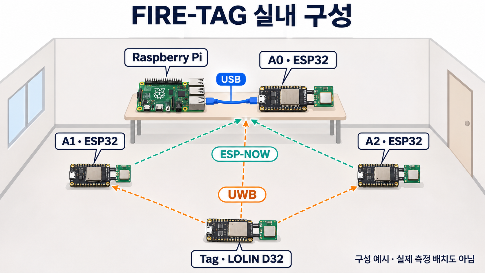
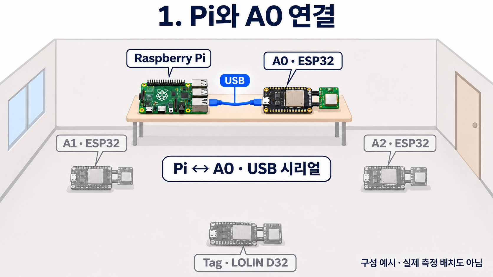
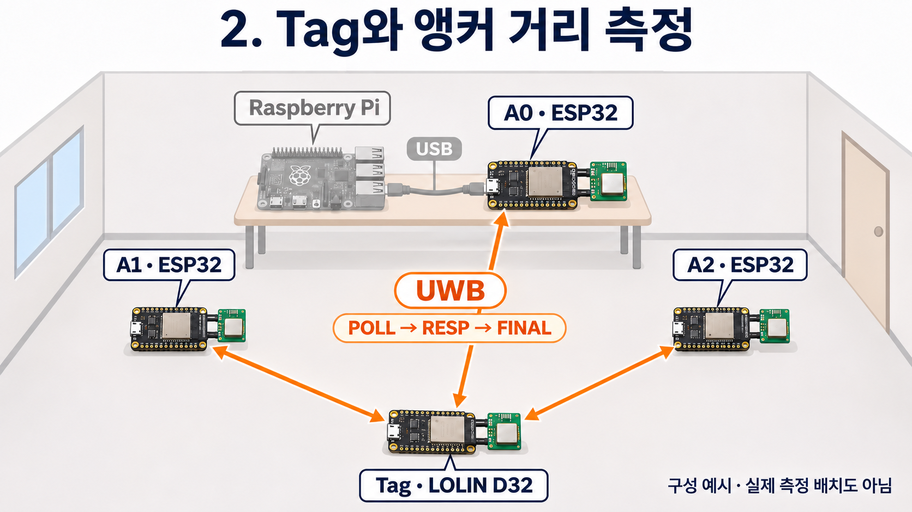
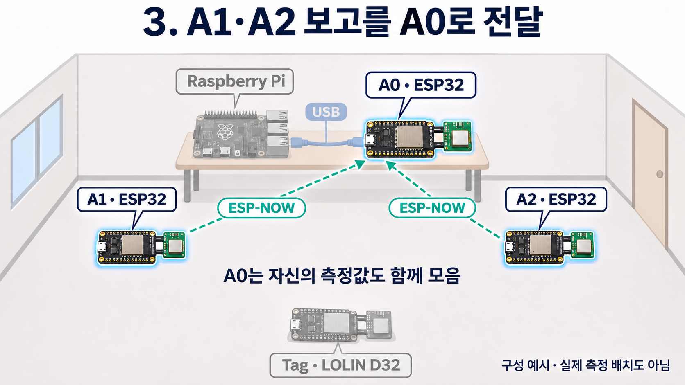
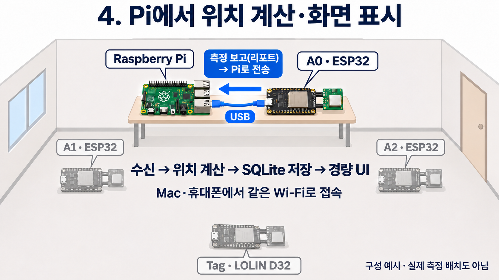
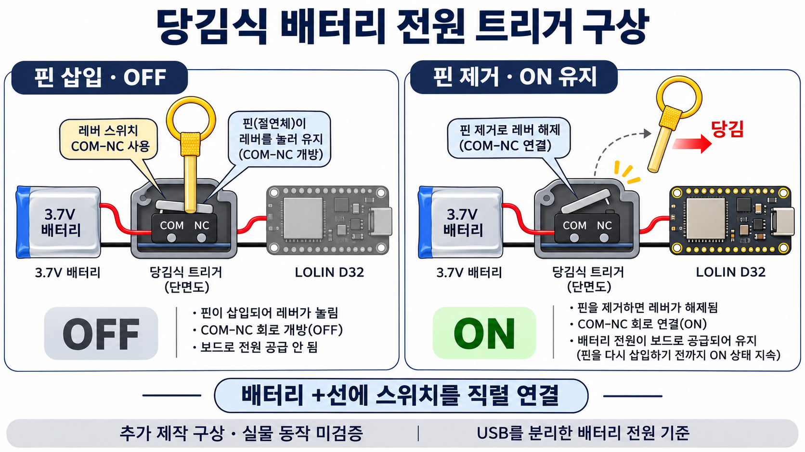
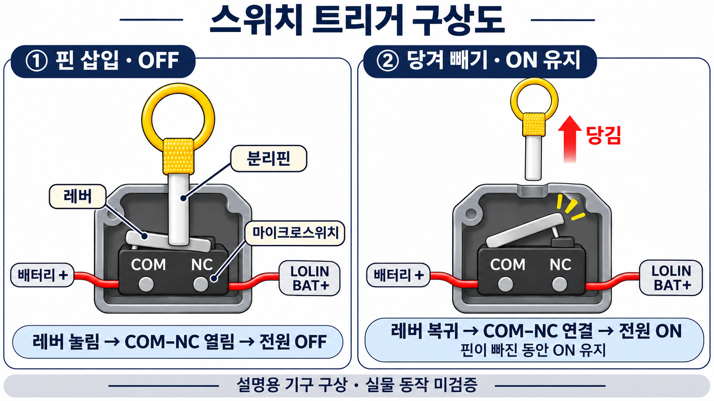

# 손그림 변경 전 원래 버전 이미지

손그림 규칙을 적용하기 전 생성 이미지 7장을 별도 보관합니다. 파일 번호는 상위 폴더의 손그림 버전과 대응합니다.

- 복원 기준: Git 커밋 `578a0ae` (손그림 변경 직전)
- 원본 파일과 바이트 일치 확인. 이미지 재생성·편집 없이 파일명과 위치만 정리.
- [현재 손그림 버전 이미지 목록](../_이미지_목록.md)
- 실제 UI 캡처는 변경 전후 동일하므로 [상위 폴더의 원본 캡처](../08_Pi_경량UI_실제화면.png)를 공통으로 사용.
- 설명용 구성·기구 구상. 실제 측정 배치도·트리거 실물 작동 검증 자료가 아님.

## 1. 실내 전체 구성

- [그림 1] 손그림 변경 전 실내 전체 구성

## 2. Pi와 A0 USB 연결

- [그림 2] 손그림 변경 전 Pi와 A0 USB 연결

## 3. Tag와 앵커 UWB 거리 측정

- [그림 3] 손그림 변경 전 Tag와 앵커 UWB 거리 측정

## 4. ESP-NOW로 A0에 보고 전달

- [그림 4] 손그림 변경 전 ESP-NOW로 A0에 보고 전달

## 5. Pi 위치 계산과 화면 표시

- [그림 5] 손그림 변경 전 Pi 위치 계산과 화면 표시

## 6. 당김식 배터리 트리거 구상

- [그림 6] 손그림 변경 전 당김식 배터리 트리거 구상

## 7. 스위치 트리거 확대 구상

- [그림 7] 손그림 변경 전 스위치 트리거 확대 구상

